# Resultados

> Generado automáticamente por `python -m demanda.pipeline reporte`. Fuente: Histórico oficial de generación bruta horaria, Coordinador Eléctrico Nacional.

## Resumen

| Indicador | Valor |
|---|---|
| Período analizado | 2018-01-01 a 2024-12-31 (61.362 horas) |
| Máximo horario | 12.190 MWh/h (2024-01-31 15:00) |
| Hora punta promedio | 21:00 · valle 04:00 |
| Fin de semana vs día hábil | -7,0 % |
| Años excluidos por calidad | 2025 (ver hallazgo) |
| Peor semana de 2020 (pandemia) | -5,7 % vs 2018-2019 |
| Temperatura de menor consumo | ≈ 16 °C |
| **Error del modelo (MAPE)** | **2,25 %** |
| Baseline semana pasada | 3,48 % |
| Baseline ayer | 4,26 % |
| Error medio absoluto | 226 MWh/h |

## Mapa de calor anual

Cada fila es un año y cada columna un día. Lo oscuro es más consumo.

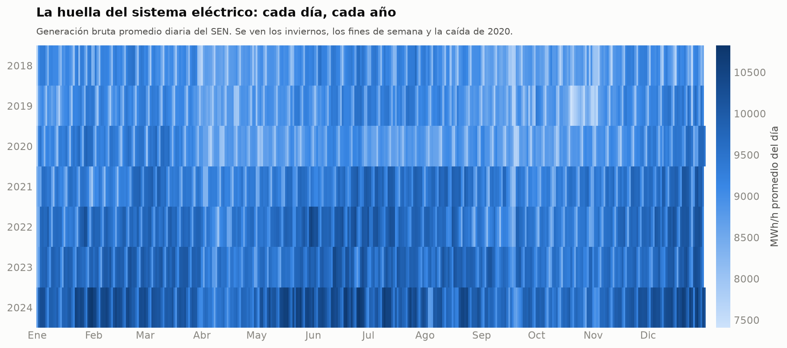

## Hora × día de la semana

El patrón semanal: valle de madrugada, meseta laboral y punta nocturna.

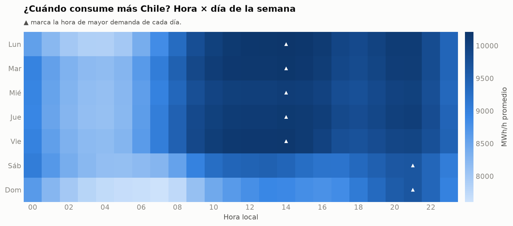

## Hora × mes

Cómo se mueve la punta durante el año.

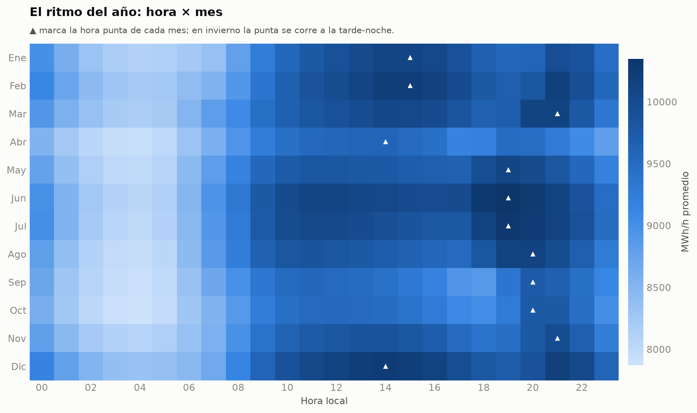

## Tendencia y crecimiento

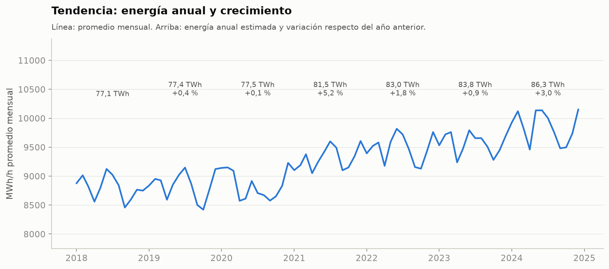

## Temperatura y consumo

El consumo sube cuando hace frío (calefacción) y cuando hace calor (refrigeración).

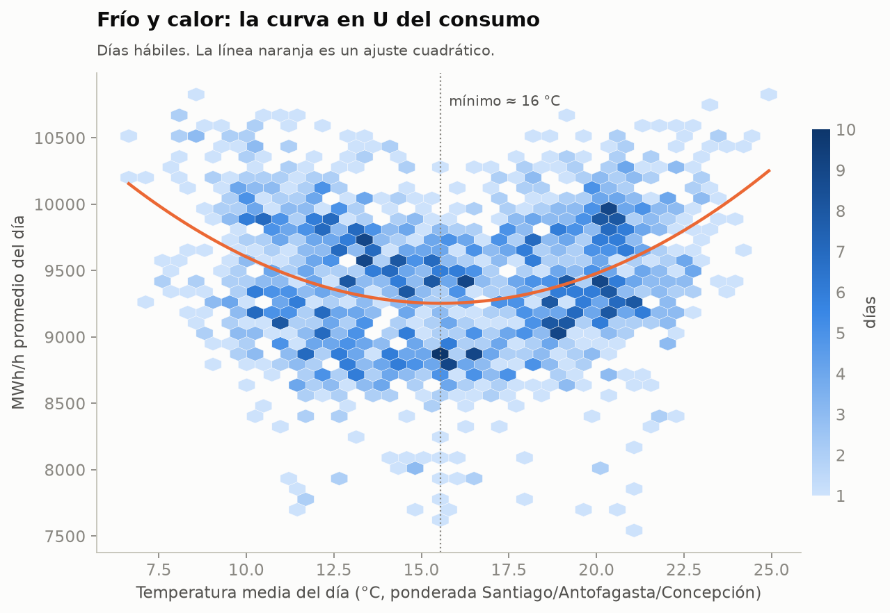

## El efecto de la pandemia

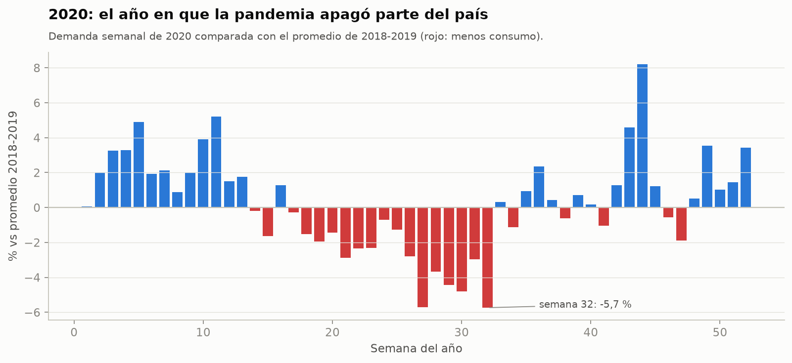

## Desempeño del modelo

Pronóstico a 24 horas evaluado sobre datos que el modelo no vio.

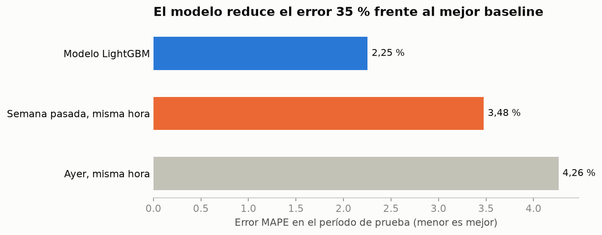

## Pronóstico vs realidad

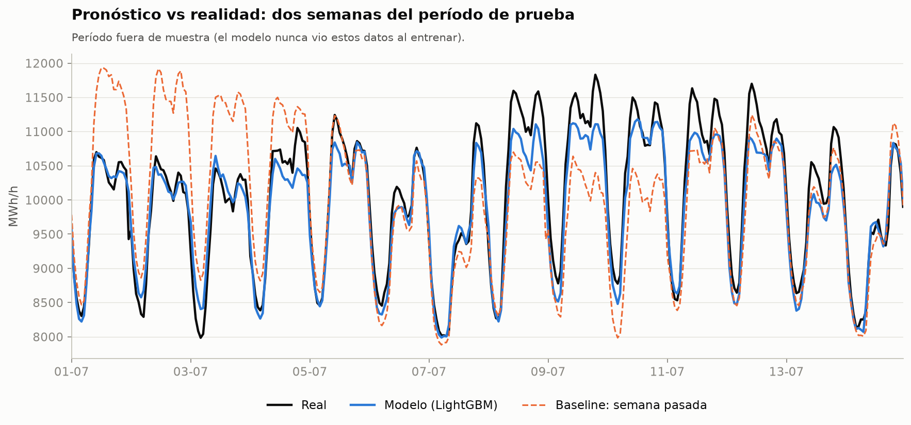

## Error por hora del día

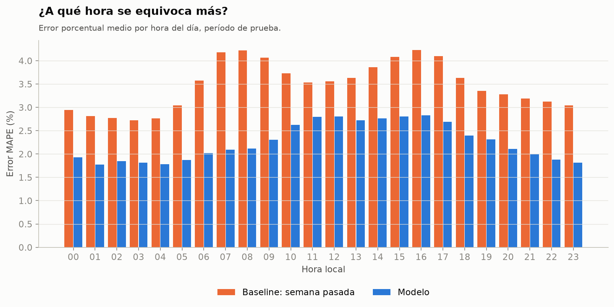

## Sesgo del modelo por hora y mes

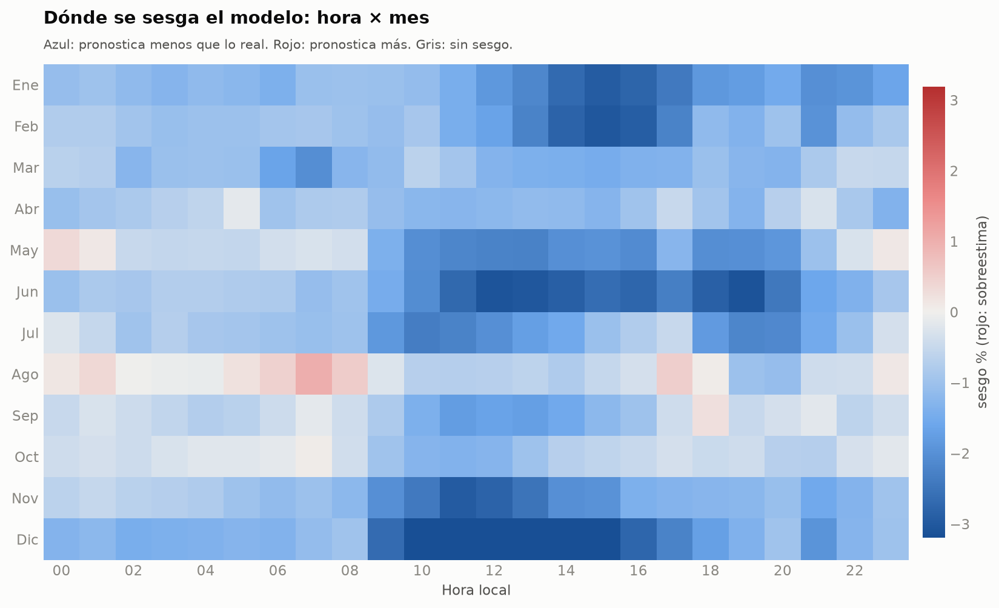

## Qué variables importan

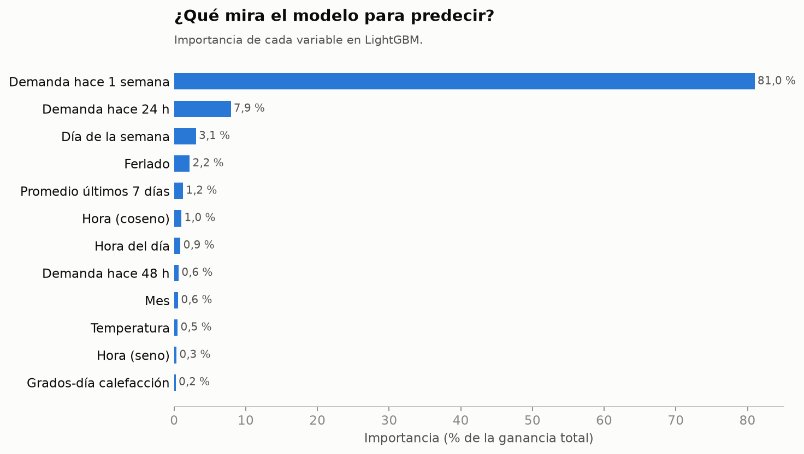

## Calidad de datos: el problema de 2025

Al comparar la forma diaria de cada año, la hoja 2025 del archivo oficial aparece desplazada unas 9 horas: la punta cae de madrugada y el valle en la noche, algo incompatible con un sistema con gran aporte solar. Por eso 2025 se excluye del entrenamiento y la evaluación (`excluir_anios` en `config/settings.yaml`). Hay que volver a revisarlo cuando el Coordinador publique una nueva versión del archivo.

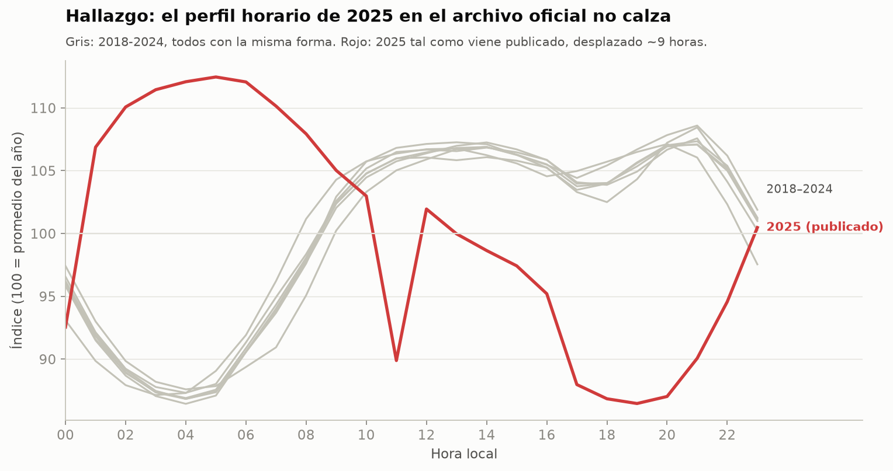
